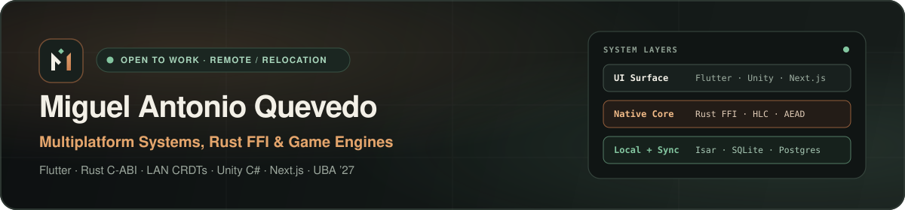

 

---

### "I design the product. I build the systems underneath."

I build **end-to-end multiplatform software** across desktop, mobile, web, native systems, and game engines — taking concepts from 0-to-1 UI fidelity (`on-model`) down to memory-safe native Rust FFI boundaries, encrypted peer-to-peer sync, and relational databases.

* **Target Roles:** `Flutter / Multiplatform Engineer` · `Rust / C-ABI FFI Systems Engineer` · `Full-Stack TypeScript Engineer`
* **Core Stack:** `Flutter` (`Skia` / `Impeller`) · `Dart` · `Rust` · `C#` (`Unity`) · `TypeScript` (`Next.js` / `Astro`) · `Kotlin` · `PostgreSQL` / `Supabase` / `Isar`
* **Availability & Location:** Aragua, Venezuela · **Remote · Hybrid · On-site · Open to relocate** · Direct: [`miguel.270799@gmail.com`](mailto:miguel.270799@gmail.com)
* **Education & Languages:** Systems Engineering (`UBA '27`, Programming Concentration) · Spanish & English (`Native / Bilingual`) · Portuguese & Italian (`Advanced`) · German & Japanese (`Basic`)

---

### Inspectable Open-Source Systems (Green CI)

Because my flagship commercial product (**Meson**) lives in a private repository (`720+` indexed private commits kept non-public to protect IP), these standalone clean-room repositories expose my Rust, C99/Dart FFI, and offline-first Dart architecture, tests, and cross-platform CI in public:

| Repository | What It Implements & Proves | Linux + Windows CI |
| :--- | :--- | :---: |
| **[`lan-delta-sync`](https://github.com/M4QSZ/lan-delta-sync)** | Offline-first LAN sync primitives in **Rust**: `HybridClock` (HLC with drift guards), `DeltaStore` (LWW CRDT + tombstones), `PeerSession` (`ChaCha20-Poly1305` AAD + 64-slot anti-replay window), bounded `RetryOutbox`, and **7 integration tests + mesh example**. |  |
| **[`ffi-arena-bridge`](https://github.com/M4QSZ/ffi-arena-bridge)** | Zero-dep Rust **C-ABI & `dart:ffi` bridge**: `u64` generational handles (zero raw-pointer UAF), `catch_unwind` panic shield, zero-copy `FfiBytesView`, double-free-safe `FfiOwnedBuffer`, deterministic trigram search, and **live C99 `cdylib` smoke binary in CI**. |  |
| **[`dart-offline-outbox`](https://github.com/M4QSZ/dart-offline-outbox)** | Transactional offline-first mutation outbox in **pure Dart**: per-entity write coalescing, jittered exponential `RetryPolicy`, partial batch ACKs (`DispatchOutcome`), dead-letter quarantine, `OutboxJournalStore`, and **strict `dart analyze --fatal-infos` + unit tests**. |  |

---

### Live Web Deployments (Vercel)

| Deployment | Stack | Scope |
| :--- | :--- | :--- |
| **[SET — Ingeniería Eléctrica & Climatización](https://set-ingenieria.vercel.app)** | `Astro` · `Tailwind CSS` · `JavaScript` | Production service website backed by centralized business/project configuration. |
| **[MedPulse SOS — Emergency QR/NFC Platform](https://pulsera-medica.vercel.app)** | `Astro` · `TypeScript` · `Supabase` | Interactive prototype for QR/NFC emergency cards, wristband catalog, and order tracking. |

---

### Selected Architecture & Product Highlights

* **Meson *(private commercial flagship)*:** Multiplatform restaurant operations suite across Desktop, Mobile, and Web — customizable Flutter shell, Flame 2D/isometric floor editor, 44-entry modular Store, local P2P network, Firebase -> Supabase SQL migration, Kotlin Android foreground service, customer community app, and delivery dispatch. *(Real desktop captures & engineering case studies at [m4qsz.github.io/en](https://m4qsz.github.io/en/))*
* **Brasas & El Pueblo del Faro:** Cross-platform action adventure (**Flutter** shared package + **Unity 6.3 LTS** `C#` with decoupled simulation & EditMode/PlayMode tests) and Roblox Studio `Luau` / Rojo prototype.
* **Technical Lab *([8 inspectable demos](https://m4qsz.github.io/en/lab/))***: Verified public modules across **Rust**, **Dart**, **C11 + NASM x64 Assembly**, **C++17**, **PHP 8.2**, and **Swift**.

<b>Versión en Español (ES) — Resumen rápido y contacto</b>

Desarrollo software multiplataforma de extremo a extremo (PC, móvil y web): interfaces **Flutter/Next.js/Astro**, lógica nativa segura en **Rust (`C-ABI` / `dart:ffi`)**, outbox transaccional offline-first en **Dart**, redes locales **P2P offline-first (`ChaCha20-Poly1305` + CRDT)**, bases locales (`Isar` / `SQLite`) + **PostgreSQL/Supabase**, videojuegos en **Unity (`C#`)** y flujos aplicados con **LLMs**.

* **Roles objetivo:** Ingeniero Flutter Multiplataforma · Ingeniero Rust / FFI · Desarrollador Full-Stack TypeScript
* **Portafolio interactivo:** [m4qsz.github.io](https://m4qsz.github.io/)
* **CV imprimible / ATS:** [m4qsz.github.io/cv](https://m4qsz.github.io/cv/)
* **Laboratorio con CI verde:** [m4qsz.github.io/laboratorio](https://m4qsz.github.io/laboratorio/)
* **LinkedIn:** [linkedin.com/in/miguel-quevedo-dev](https://www.linkedin.com/in/miguel-quevedo-dev/)
* **Contacto directo:** `miguel.270799@gmail.com`

