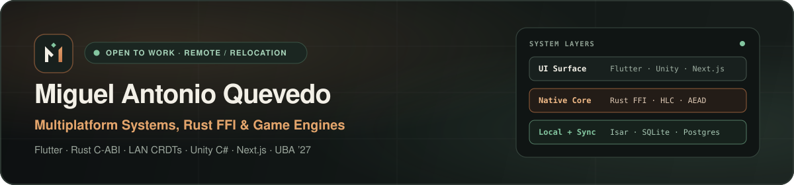

 

---

### "I design the product. I build the systems underneath."

I build **end-to-end multiplatform software** across desktop, mobile, web, native systems, and game engines — taking concepts from 0-to-1 UI fidelity (`on-model`) down to memory-safe native Rust FFI boundaries, encrypted peer-to-peer sync, and relational databases.

* **Target Roles:** `Rust Systems & AI Agent Infrastructure Engineer (MCP / GPUI)` · `Flutter / Multiplatform Engineer` · `Rust / C-ABI FFI Engineer` · `Full-Stack TypeScript Engineer`
* **Core Stack:** `Rust` (`GPUI CE 0.3.0` / `MCP stdio` / `Iroh QUIC` / `C-ABI FFI`) · `Flutter` (`Skia` / `Impeller`) · `Dart` · `Kotlin` (`Android`) · `TypeScript` (`Next.js` / `Astro`) · `C#` (`Unity`) · `Luau` (`Roblox`) · `PostgreSQL` / `Supabase` / `Isar`
* **Availability & Location:** Aragua, Venezuela · **Remote · Hybrid · On-site · Open to relocate** · Direct: [`miguel.270799@gmail.com`](mailto:miguel.270799@gmail.com)
* **Education & Languages:** Systems Engineering (`UBA '27`, Programming Concentration) · Spanish & English (`Native / Bilingual`) · Portuguese & Italian (`Advanced`) · German & Japanese (`Basic`)

---

### Inspectable Open-Source Systems (Green CI)

Because my flagship commercial product (**Meson**) lives in a private repository (`720+` indexed private commits kept non-public to protect IP), these standalone clean-room repositories expose my Rust, C99/Dart FFI, and offline-first Dart architecture, tests, and cross-platform CI in public:

| Repository | What It Implements & Proves | Linux + Windows CI |
| :--- | :--- | :---: |
| **[`lan-delta-sync`](https://github.com/M4QSZ/lan-delta-sync)** | Offline-first LAN sync primitives in **Rust**: `HybridClock` (HLC with drift guards), `DeltaStore` (LWW CRDT + tombstones), `PeerSession` (`ChaCha20-Poly1305` AAD + 64-slot anti-replay window), bounded `RetryOutbox`, and **7 integration tests + mesh example**. |  |
| **[`ffi-arena-bridge`](https://github.com/M4QSZ/ffi-arena-bridge)** | Zero-dep Rust **C-ABI & `dart:ffi` bridge**: `u64` generational handles (zero raw-pointer UAF), `catch_unwind` panic shield, zero-copy `FfiBytesView`, double-free-safe `FfiOwnedBuffer`, deterministic trigram search, and **live C99 `cdylib` smoke binary in CI**. |  |
| **[`dart-offline-outbox`](https://github.com/M4QSZ/dart-offline-outbox)** | Transactional offline-first mutation outbox in **pure Dart**: per-entity write coalescing, jittered exponential `RetryPolicy`, partial batch ACKs (`DispatchOutcome`), dead-letter quarantine, `OutboxJournalStore`, and **strict `dart analyze --fatal-infos` + unit tests**. |  |

---

### Live Web Deployments (Vercel)

| Deployment | Stack | Scope |
| :--- | :--- | :--- |
| **[SET — Ingeniería Eléctrica & Climatización](https://set-ingenieria.vercel.app)** | `Astro` · `Tailwind CSS` · `JavaScript` | Production service website backed by centralized business/project configuration. |
| **[MedPulse SOS — Emergency QR/NFC Platform](https://pulsera-medica.vercel.app)** | `Astro` · `TypeScript` · `Supabase` | Interactive prototype for QR/NFC emergency cards, wristband catalog, and order tracking. |

---

### Selected Architecture & Product Highlights

* **Meson *(private multiplatform ecosystem — `769/860` active-branch commits)*:** Lead architect & principal engineer across **7 specialized Flutter/Astro apps** and **10 decoupled Dart/Isar packages**:
  * **`meson_business` *(527 test files · 33 sub-apps + 18 desktop OS tools)*:** Multi-vertical POS/Retail, self-checkout kiosks, KDS, BOM recipe costing, double-entry accounting, fiscal invoicing, **B2B supplier marketplace** *(80 files)*, **subscription tiers**, **`device_hub`** *(Customer-Facing Displays, scales, ESC/POS USB/LAN/BLE printers, NFC)*, WebView2 multi-tab browser, unified audio/video/image player, Rust calculator, layered shell personalization *(176 files)*, embedded games *(`Flame` / `meson_brasas`)*, platform-specific stubs, and **Atelier** *(LinkedIn-style hiring pipeline, interviews, RBAC, shifts, payroll & Cedula/PIN attendance kiosk)*.
  * **49 Rust APIs & 8 Crates (`flutter_rust_bridge`):** Custom **DAG dependency spreadsheet engine** + XLSX export (`meson_tools`), local **TF-IDF/SIF NLP & SQLite RAG** engine (`meson_ai`), `qbsdiff` binary delta updater (`meson_shell`), SIMD media (`meson_media`), procedural 3D, WebRTC, LAN P2P (`AES-256-GCM` + 128-bit replay window), and delegated `AES-256` cipher hooks for `meson_chat`.
  * **Satellite Apps & Web:** **`meson_central`** *(SaaS financial super-admin, cryptographic node licensing, cloud costs & fleet monitor)*, **`meson_delivery`** *(GPS, biometrics, QR/NFC proof & offline peer mesh relay)*, **`meson_customer`** *(social Radar + Rust backend)*, **`meson_pause`** *(wellness/fasting + 15 tests)*, **`meson_currency`**, public **[`BUCO`](https://github.com/M4QSZ/BUCO)** *(22 tests)*, and **`300+` page Astro platform**. *(Real captures & architecture notes at [m4qsz.github.io/en](https://m4qsz.github.io/en/)) — collaborator `ljga_` contributed UI widgets & Flutter screens (~10.6% of commits).*
* **Cockpit v2.0 *(private Rust + GPUI CE 0.3.0 + concurrent MCP stdio orchestrator — `68k+` LOC Rust · `216` passing unit tests — [Technical Report](https://m4qsz.github.io/en/lab/cockpit-paper/) · [PDF](https://m4qsz.github.io/papers/cockpit-orchestrator-paper.pdf) · [Case Study](https://m4qsz.github.io/en/projects/cockpit/))*:** Native desktop orchestrator and concurrent stdio MCP server unifying Claude Code, Codex CLI, Antigravity, and OpenCode under live 5h/7d quota telemetry, Git worktree pre-merge quality gates, and split diff review.
  * **Measured Deterministic Token Compression:** **94.13%** avg skeleton token reduction (`97.07%` on `app.rs` in `38 ms`), **84.94%** CLI output filtering (`96.83%` on `cargo test`), **88.34%–97.31%** 18-turn session compaction, and **3/3** `LoopGuard` catches (`0 FP`).
  * **Distributed Remote & Zero-Vision-Token MCPs:** Multi-device orchestration over **Iroh QUIC**, **Tailscale Serve**, and a native **Android Kotlin** companion client, plus zero-vision-token automation MCPs for **Win32 UIA** desktop control, **Blender 3D** modeling/rigging, **Roblox** (`Luau` / `Rojo` / `Lune`), and **FFmpeg** video keyframe/edit pipelines.
* **Brasas & El Pueblo del Faro:** Cross-platform action adventure (**Flutter** shared package + **Unity 6.3 LTS** `C#` with decoupled simulation & EditMode/PlayMode tests) and Roblox Studio `Luau` / Rojo prototype.
* **Technical Reports & Lab *([m4qsz.github.io/laboratorio](https://m4qsz.github.io/laboratorio/) · [EN Lab](https://m4qsz.github.io/en/lab/))*:**
  * **Technical Reports (4):** [Cockpit v2.0 Architecture & Token Optimization](https://m4qsz.github.io/en/lab/cockpit-paper/) · [Zero-Vision MCP Automation (Win32 UIA, Blender, Roblox, FFmpeg)](https://m4qsz.github.io/en/lab/cockpit-zero-vision/) · [Distributed Multi-Device Orchestration (Iroh QUIC, Tailscale, Android Kotlin)](https://m4qsz.github.io/en/lab/cockpit-distributed/) · [Algebraic Context Compression & KV-Cache Epoch Laws](https://m4qsz.github.io/en/lab/cockpit-algebraic-compression/)
  * **Inspectable Demos:** Verified public modules across **Rust**, **Dart**, **C11 + NASM x64 Assembly**, **C++17**, **PHP 8.2**, and **Swift**.

<b>Versión en Español (ES) — Resumen rápido y contacto</b>

Desarrollo software multiplataforma e infraestructura de sistemas de extremo a extremo (PC, móvil y web): orquestación de agentes IA y servidores **MCP concurrentes en Rust (`GPUI CE 0.3.0`, `Iroh QUIC`, `Tailscale`, `Kotlin`)**, interfaces **Flutter/Next.js/Astro**, lógica nativa segura en **Rust (`C-ABI` / `dart:ffi`)**, outbox transaccional offline-first en **Dart**, redes locales **P2P offline-first (`ChaCha20-Poly1305` + CRDT)**, bases locales (`Isar` / `SQLite`) + **PostgreSQL/Supabase**, y pipelines automatizados para **Unity (`C#`)**, **Roblox (`Luau`/`Rojo`/`Lune`)** y **Blender 3D**.

* **Roles objetivo:** Ingeniero de Sistemas Rust e Infraestructura de Agentes IA (MCP) · Ingeniero Flutter / Rust FFI · Desarrollador Full-Stack TypeScript
* **Portafolio interactivo:** [m4qsz.github.io](https://m4qsz.github.io/)
* **CV imprimible / ATS:** [m4qsz.github.io/cv](https://m4qsz.github.io/cv/)
* **Reportes Técnicos y Laboratorio (CI verde):** [m4qsz.github.io/laboratorio](https://m4qsz.github.io/laboratorio/) · [Paper Cockpit v2.0](https://m4qsz.github.io/laboratorio/cockpit-paper/)
* **LinkedIn:** [linkedin.com/in/miguel-quevedo-dev](https://www.linkedin.com/in/miguel-quevedo-dev/)
* **Contacto directo:** `miguel.270799@gmail.com`

